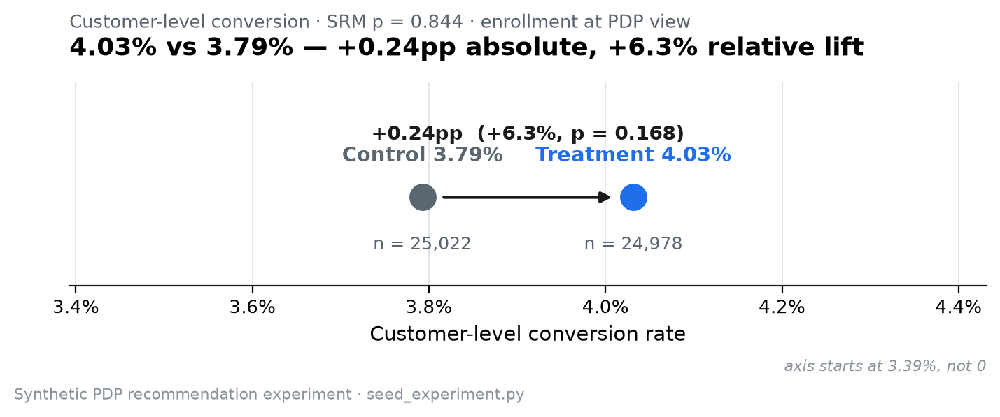
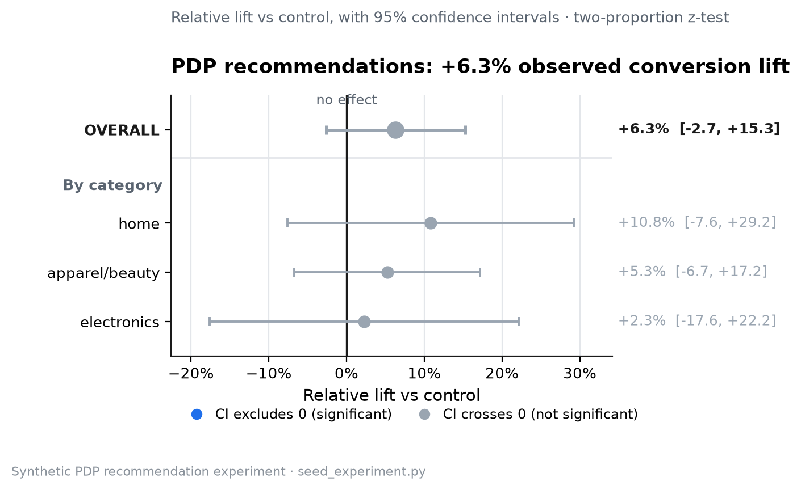
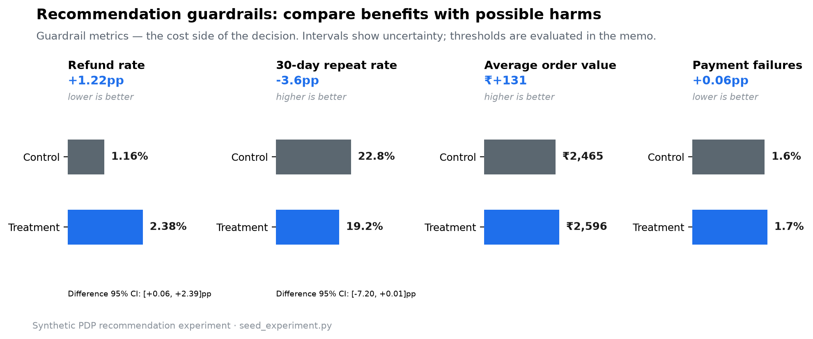

# Personalized PDP Recommendations v2

**Option 2 | Experiment 202 | 50,000 synthetic customers**

An independent adaptation of the
[Option 1 reference skeleton](https://github.com/anujhsrsaini/ab-test-pdp-strikethrough).
All v2 data is generated and controlled in `seed_experiment.py`; no production
database or credentials are required. This project demonstrates simulation,
customer assignment, SQL analysis, statistical inference, and a decision memo.

[Test plan](PRE_REGISTRATION.md) | [Design](DESIGN.md) |
[Notebook](analysis/analysis.ipynb) | [Decision memo](decision_memo.md)

## Simulation configuration
| Category | Share | Control CR | Treatment relative lift |
|---|---:|---:|---:|
| apparel_beauty | 50% | 4.2% | +15% |
| electronics | 25% | 3.2% | +8% |
| home | 25% | 3.6% | +12% |

Expected aggregate conversion: **3.800% -> 4.287%**, a **12.82% relative lift**.
Refund probabilities: **1.2% -> 1.5%**. Mean AOV: **INR 2,500 -> INR 2,620**.
The RNG seed remains **20260617**. Expected rates are inputs, not fixed outcome
quotas or guarantees of significance. Actual draws vary from expectation.

## Run locally
From this project directory, using Python 3.11 or a compatible environment:

```powershell
python -m venv .venv
.venv/Scripts/python.exe -m pip install -r requirements.txt
.venv/Scripts/python.exe seed_experiment.py
.venv/Scripts/python.exe -X utf8 make_figures.py
.venv/Scripts/python.exe -m pytest -q
.venv/Scripts/python.exe -m jupyter nbconvert --to notebook --execute analysis/analysis.ipynb --inplace
```

With dependencies already installed, `python seed_experiment.py` is sufficient
for data generation. Outputs: `data/assignments.csv`, `data/orders.csv`,
`data/experiment.duckdb`, and `data/seed_config.json`. Use `--output-dir PATH`
for a separate fixture. The database contains `experiments`,
`experiment_variants`, `experiment_assignments`, and `orders`.

`.gitignore` excludes `.env`, environment files, and all `*.duckdb`, SQLite,
and database journal files. Only synthetic CSVs are versioned. The original
reference repository and its Git remote are unchanged.

## Default synthetic readout
SRM first: chi-square **0.0387**, p **0.844004**; passes.

| Metric | Control | Treatment |
|---|---:|---:|
| Assigned customers | 25,022 | 24,978 |
| Paid converters (7 days) | 949 | 1,007 |
| Conversion | 3.793% | 4.032% |
| Mean order value (INR) | 2,465.18 | 2,595.93 |
| Revenue/customer before refunds (INR) | 93.50 | 104.66 |
| Refund rate among converters | 1.159% | 2.383% |
| Repeat rate among converters | 22.76% | 19.17% |
| Bounce | 25.150% | 26.523% |
| PDP p95 latency (ms) | 1477.5 | 1558.0 |

Observed conversion lift: **+6.30% relative / +0.239pp**;
Z = **1.378**, two-sided p = **0.1683**.
95% absolute CI: **[-0.101, +0.579]pp**;
approximate relative CI: **[-2.66%, +15.26%]**.
The primary result is not statistically significant at alpha 0.05.

**Decision: do not infer production readiness.** This realization is inconclusive
on conversion, and refund/other guardrail uncertainty requires review. The data
is synthetic; it is not evidence of actual customer behavior.





## Validation and limits
- Deterministic SHA-256 customer assignment; SRM p < 0.001 stops outcome analysis.
- SQL and Python agree on all-customer ITT and the half-open seven-day order window.
- Tests cover reproducible CSVs, experiment metadata, category distributions,
  mean AOV, attribution boundaries, and statistical agreement with statsmodels.
- Category effects are imposed by simulation; exploratory estimates remain noisy.
- The requested sample is slightly below the approximate 25,678 per arm needed
  for 80% power at the configured expected effect. It is not resized after results.
- Bounce, latency, refund, and repeat observations are simulated. Revenue is
  before refunds. A real launch requires actual outcomes and contribution margin.
- Notebook and charts recompute; refresh README/memo if changing the seed configuration.

Historical utilities are optional; see [BASELINE.md](BASELINE.md).
